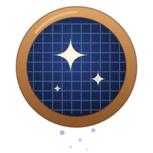

<p align="center"></p>

# AstroCheck

**Tri et analyse des brutes d'astrophotographie avant l'empilement.**

AstroCheck affiche vos images FITS, CR2 et vidéos SER, mesure chaque brute (FWHM, rondeur des étoiles, nombre d'étoiles, fond de ciel), les classe de la meilleure à la plus mauvaise et écarte d'office celles qui gâcheraient l'empilement. Il prépare ensuite un dossier prêt pour **PixInsight** (WBPP) ou **Siril**.

Pensé pour l'ASIAIR et le **Dwarf 3**, il fonctionne avec tout logiciel d'acquisition qui écrit des FITS.

## Ce qu'il fait

- **Affichage rapide** des FITS, CR2 et SER, avec étirement automatique, débayérisation et lecture vidéo.
- **Analyse et classement** : score de qualité, présélection automatique des images floues, voilées ou filées, avec des seuils relatifs à la série.
- **Graphique de la nuit** : FWHM, excentricité, étoiles, fond, rotation et hauteur de l'objet au fil des heures, sur une ou plusieurs nuits.
- **Vue des coins** : inclinaison du capteur, courbure de champ, coma.
- **Rotation de champ** (monture alt-azimutale) : angle de chaque image, vitesse, filé dans les coins, pose maximale conseillée.
- **Zone utile après empilement** : ce qui restera après recadrage, et les images qui la réduisent.
- **Choix de la référence** : meilleur score, image de votre choix, ou première image comme le Dwarf 3.
- **Contrôle des darks et des flats** : pose, gain, température, lumière parasite, saturation, motif.
- **Bilan de la séance** : coût du tri en signal/bruit, comparaison des nuits, dérive de la mise au point avec la température, traînées de satellites.
- **Aperçu d'empilement rapide** : les brutes gardées alignées et empilées en quelques secondes, comparées à une image seule et à l'empilement avec les rejetées, avec **résolution astrométrique** (ASTAP ou Siril) et grille RA/DEC.
- **Journal pour AstroPlan**, envoyé automatiquement sur le serveur si vous le souhaitez.
- **Séries** : caméras TELE et WIDE du Dwarf 3, filtres, poses et gains traités séparément.
- **Export** vers Siril ou PixInsight, avec script de prétraitement Siril, score en mot-clé FITS (`ACWEIGHT`) pour ImageIntegration, et compositions HOO / SHO synthétique pour les filtres bi-bande.

Vos fichiers ne sont jamais modifiés : les rejets se font dans la liste, et rien ne bouge sur le disque sans votre accord.

## Installation (Linux)

Dépendances, à installer une seule fois :

```bash
# Debian 12, Ubuntu 22.04, Linux Mint 21 ou plus récents
sudo apt install python3-pyqt6 python3-numpy python3-astropy
# Fedora : sudo dnf install python3-pyqt6 python3-numpy python3-astropy
# Arch   : sudo pacman -S python-pyqt6 python-numpy python-astropy
```

Puis, dans le dossier du dépôt :

```bash
sh installer_astrocheck.sh
```

AstroCheck apparaît dans le menu des applications. Pour lire les CR2, installez aussi `dcraw` (ou le module Python `rawpy`).

Sans installation, vous pouvez aussi le lancer directement :

```bash
python3 astrocheck.py ~/Astro/NGC7380
```

## Utilisation en bref

1. Glissez-déposez le dossier de la séance (brutes, darks, flats…).
2. **Ctrl+R** : analyser et classer. Les images écartées apparaissent en orange.
3. Parcourez-les avec ↑ ↓, **Espace** pour garder ou rejeter.
4. **Ctrl+B** : bilan de la séance, **Ctrl+U** : rotation et zone utile.
5. **Ctrl+Maj+S** : exporter vers PixInsight ou Siril.

La notice complète est dans [NOTICE.md](NOTICE.md).

## Licence

AstroCheck est un logiciel libre, distribué sous licence [GPL-2.0](LICENSE).
